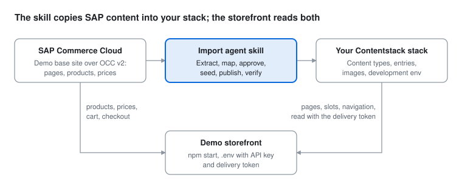

# Set Up the SAP Composable Storefront Demos

Run the electronics (B2C) or powertools (B2B) demo storefront on your own Contentstack stack, seeded in a few minutes by the **SAP Spartacus content import** agent skill (`dx-sap-spartacus-import`).

Both demos are built on SAP Composable Storefront (Spartacus) and the [SAP Spartacus Connector](https://www.contentstack.com/docs/marketplace/spartacus-contentstack-connector). They read page content (homepage, navigation, footer and marketing slots) from Contentstack, while SAP Commerce Cloud keeps products, prices, search, cart and checkout. Pages and slots that aren't authored in Contentstack fall back to SAP automatically.

You don't build the demo content by hand. The skill reads the content the SAP site already serves and recreates it in your stack, in the model the connector reads.

> This guide covers both demo repositories. It is the source for the official setup guide on contentstack.com/docs.

## What You Will Learn

- Install a demo storefront.
- Seed an empty stack from the demo's SAP site with the agent skill.
- Add the German, Japanese and Chinese languages.
- Optionally, let editors pick carousel products from SAP with the SAP Commerce Cloud app.
- Connect the storefront to your stack, run it, and check that content comes from Contentstack.

## The Two Demos

Both demos use the same app code, connector and setup steps; only the SAP base site differs. Wherever a step says `<base-site>`, use your demo's value.

|  | Electronics | Powertools |
| --- | --- | --- |
| Repository | [sapcc-storefront-electronics-demo](https://github.com/contentstack/sapcc-storefront-electronics-demo) | [sapcc-storefront-powertools-demo](https://github.com/contentstack/sapcc-storefront-powertools-demo) |
| Channel | B2C | B2B |
| SAP base site | `electronics-spa` | `powertools-spa` |
| Pages imported | `/`, `/faq`, `/contact`, `/sale`, product layout, category layout | Same |
| Content imported | 111 component entries, 37 images | 83 component entries, 41 images |
| Languages | en, de, ja, zh | en, de, ja, zh |
| SAP product picker on carousels | Optional | Optional |

## Prerequisites

- **Node.js** `^22.22.0`. Older 22.x versions print non-fatal `EBADENGINE` warnings.
- **Angular CLI 21**. `npx -p @angular/cli@21 ng ...` works without a global install.
- **SAP RBSC registry access**. The `@spartacus/*` packages come from SAP's Repository-Based Shipment Channel, not public npm.
- **An SAP Commerce Cloud backend** that serves the demo's base site over OCC v2. Each demo's `proxy.conf.json` names the server it uses during development.
- **An empty Contentstack stack** per demo, with master locale **English - United States (`en-us`)**. The import publishes everything in the stack, so don't reuse a stack that holds other content.
- **The Contentstack CLI**, logged in with OAuth. Pick the organization that holds your stack when the browser asks; orgs with SSO reject a basic email and password login, and the SAP Commerce Cloud app step needs OAuth.

  ```bash
  npm install -g @contentstack/cli
  csdx config:set:region <region>       # NA, EU, AZURE-NA, ... to match your stack
  csdx auth:login --oauth
  ```

- **Python 3.9 or later**. The skill's scripts use only the standard library.
- **An AI coding agent with the Contentstack agent skills**, for example Claude Code, Cursor, Codex, GitHub Copilot or Gemini CLI. See [Contentstack agent skills](https://github.com/contentstack/contentstack-agent-skills#install). In Claude Code:

  ```
  /plugin marketplace add contentstack/contentstack-agent-skills
  /plugin install contentstack-skills@contentstack-skills
  ```

## How the Setup Works



The skill reads the demo's SAP site once and writes its content into your stack. At runtime the storefront reads pages, slots and navigation from the stack with a read-only delivery token, and keeps products, prices, cart and checkout on SAP.

## Step 1: Install the Demo

1. Clone the demo you want (electronics shown):

   ```bash
   git clone https://github.com/contentstack/sapcc-storefront-electronics-demo.git
   cd sapcc-storefront-electronics-demo
   ```

2. Create a `.npmrc` in the project root for the RBSC registry. The file is gitignored; it holds an organization credential, so never commit it.

   ```ini
   @spartacus:registry=https://<YOUR_RBSC_REGISTRY_HOST>/
   //<YOUR_RBSC_REGISTRY_HOST>/:_auth=<YOUR_RBSC_BASE64_AUTH>
   legacy-peer-deps=true
   ```

3. Install the dependencies. This also installs the connector, whose starter pack (the content types) the import reads from `node_modules`.

   ```bash
   npm install
   ```

## Step 2: Seed Your Stack With the Agent Skill

The skill imports the demo's content, publishes it to `development` and checks it against SAP; it asks before it writes anything. Run these from the demo's project root, in the terminal where your agent runs.

1. Export the settings in your own shell. Don't paste tokens into the chat. Outside North America, also export `CS_REGION_BASE` and `CS_CDA_BASE`, for example `https://eu-api.contentstack.com` and `https://eu-cdn.contentstack.com`.

   ```bash
   export CS_API_KEY=<your stack API key>
   export OCC_BASE_URL=https://<sap-host>/occ/v2   # the server in proxy.conf.json
   export OCC_INSECURE_TLS=1                      # only for a self-signed dev server you trust
   ```

2. Ask your agent, for example: *Import the `electronics-spa` SAP storefront into my Contentstack stack, with German, Japanese and Chinese.* The agent loads the `dx-sap-spartacus-import` skill and starts with a **dry run**, which writes nothing. It reports the pages, component entries and images it will create, the slots that stay with SAP (search box, mini cart, site context, site links), and any SAP component types it doesn't recognize.
3. Review the two approval steps:
   - **Model approval.** For each unknown component type, decide whether it's authored content (map it) or functional (leave it to SAP). The demo sites have none.
   - **Pre-publish.** The agent names the stack, the environment (`development`) and the counts, and warns that everything in the stack will be published. Confirm to continue.
4. The agent imports the content types, uploads the images, creates the entries, creates the `development` environment, publishes, and checks the result against SAP. With languages requested, it repeats the import per locale (`de-de`, `ja-jp`, `zh-cn`) and publishes each one.

The dry run takes about 2 minutes. The full import with three languages takes about 45 minutes, so let your agent run it in the background. The import is safe to re-run: it updates entries in place, keyed by their SAP ids, and never creates duplicates. The last check reads the home page through the Delivery API; on a first run it shows `check` instead of `pass`, because the delivery token doesn't exist until Step 4.

To run the skill's scripts yourself instead (`<SKILL_DIR>` is the installed skill folder):

```bash
# dry run
python3 "<SKILL_DIR>/scripts/orchestrate.py" --site <base-site>
# write, publish and verify, with languages
python3 "<SKILL_DIR>/scripts/orchestrate.py" --site <base-site> \
  --approve-model --approve-publish --env development \
  --locales de=de-de,ja=ja-jp,zh=zh-cn
```

## Step 3 (Optional): Let Editors Pick Carousel Products From SAP

The import can install the **SAP Commerce Cloud** marketplace app on the stack and fill a `sap_products` field, so editors pick carousel products visually from SAP instead of typing product codes into the plain `products` list.

The connector reads `sap_products` first and falls back to `products`, so the storefront carousels show exactly the products editors pick.

Before running Step 2, also export the SAP server the picker searches. Use base site `electronics` for the electronics demo and `powertools-spa` for powertools; the server must carry the same catalog as the demo's own SAP server:

```bash
export SAP_APP_API_BASE_URL=<sap-api-host>                 # host only, no https://
export SAP_APP_BASE_SITE=<picker base site>                 # electronics or powertools-spa
export SAP_APP_BACKOFFICE_URL=<backoffice-host>/backoffice
```

With all three set, the dry run first checks that SAP server: its certificate is publicly trusted, the base site exists, product search returns products without a login, and the carousels' product codes are on it. If a check fails, the run stops before anything is installed and names the fix. Otherwise the import installs and configures the app once, adds the picker to the carousel content type and fills it. Then open a carousel entry (for example **Our Bestselling Products**) and check that the **SAP Products** field lists products; the first load after the install can take about a minute.

## Step 4: Connect the Storefront to Your Stack

1. In your stack, go to **Settings > Tokens** and create a **Delivery token** scoped to the `development` environment. To use Live Preview, also generate its **preview token**.
2. Create `.env` from the example and fill it in:

   ```bash
   cp .env.example .env
   ```

   ```ini
   CS_API_KEY=<your stack API key>
   CS_DELIVERY_TOKEN=<your delivery token>
   CS_ENVIRONMENT=development
   CS_REGION=US          # US, EU, AU, AZURE_NA, AZURE_EU, GCP_NA or GCP_EU
   CS_LIVE_PREVIEW=false
   ```

3. Start the storefront with `npm start`, not `ng serve`. `npm start` first writes `src/environments/contentstack.environment.ts` from `.env` (the file is gitignored), then serves the app.

   ```bash
   npm start
   ```

4. Open `http://localhost:4200/`.

On a hosting platform, set the same variables as environment variables instead of a `.env` file, and build with `npm run build`.

## Step 5: Check the Result

- The homepage shows the demo's banners, carousels, navigation and footer, with no red error banner.
- In the browser's developer tools, the **Network** tab shows requests to `cdn.contentstack.io` (or your region's CDN) for `landing_page` and `global_slots`, and banner images load from `images.contentstack.io`.
- Switch the language in the header to **Deutsch**. The page reloads with German content, and the Contentstack requests carry `locale=de-de`.
- Edit a banner title in Contentstack, publish it to `development` and reload the page. The new title appears.

## Step 6 (Optional): Edit With Live Preview

Live Preview shows unsaved edits on the running storefront. The import already sets the `development` environment's preview URL to `http://localhost:4200` for every locale; you turn the feature on.

1. In your stack, go to **Settings > Visual Experience**. Under **Live Preview**, tick **Enable Live Preview**, set **Default Preview Environment** to `development`, and click **Save**.
2. In `.env`, set `CS_LIVE_PREVIEW=true` and `CS_PREVIEW_TOKEN=<the preview token from Step 4>`, then restart `npm start`. The startup line shows `livePreview=true`.
3. Open an entry, for example the **Homepage** landing page, and click the Live Preview icon in the right sidebar. The first time, choose `development` under **Select Environment** and click **Show Live Preview**.
4. Edit a field without saving, for example a navigation node's **Title**. The preview updates on its own. Use the full-screen button in the preview toolbar to see the desktop layout; the side panel shows the storefront's mobile layout, which hides the category menu.

The storefront and the Contentstack tab must run in the same browser. If the preview stays blank, allow the browser's local network access for `app.contentstack.com` when it asks.

## Troubleshooting

Find your symptom in the first column. For connector issues not listed here, see the [connector install guide's troubleshooting](https://www.contentstack.com/docs/marketplace/spartacus-contentstack-connector).

| Symptom | Cause | Fix |
| --- | --- | --- |
| `npm install` fails with 401, 403 or 404 on `@spartacus/*` | The RBSC registry isn't configured | Check the `.npmrc` in the project root (Step 1); `_auth` is your base64-encoded RBSC credential |
| The import fails with `CERTIFICATE_VERIFY_FAILED` | The SAP server uses a self-signed certificate | For a dev server you own and trust, `export OCC_INSECURE_TLS=1` and re-run. Never for production: give the server a trusted certificate |
| The import says the starter pack wasn't found | It ran outside the project root, or before `npm install` | Run it from the demo's root after `npm install`; it reads `node_modules/@contentstack/contentstack-spartacus-connector/import-export/starter-pack` |
| The import stops at model approval (exit code 2) | The SAP site uses a component type the skill doesn't know | Tell the agent whether each one is authored content or functional, then re-run the dry run |
| The import stops at pre-publish with a starter-pack mismatch (exit code 3) | The installed connector is older than the import expects | `npm i @contentstack/contentstack-spartacus-connector@latest`, then re-run. Don't edit the stack's content types by hand |
| The import stops at pre-publish with exit code 4 (SAP picker preflight) | The SAP server the picker searches can't serve it: an untrusted certificate, a missing base site, an empty search index, search behind a login, or a catalog without the carousel codes | Fix what the `FAIL` line names (for example run a full `powertoolsIndex` for an empty search), or run without the picker (`--carousel-field products`) |
| `csdx not found` or `not logged in` | No CLI session | Install `@contentstack/cli` and run `csdx auth:login --oauth`, or export `CS_MANAGEMENT_TOKEN`; the SAP app step still needs OAuth |
| The delivery check shows `check` instead of `pass` | No delivery token on the first run, or the read timed out right after a large publish | After Step 4, or a minute later, ask the agent to re-run the delivery check |
| `npm start` stops with `Missing required env var(s)` | `.env` is missing or incomplete | Create it from `.env.example` with `CS_API_KEY` and `CS_DELIVERY_TOKEN` (Step 4) |
| `ng serve` or `ng build` fails with `Cannot find module '.../environments/contentstack.environment'` | That file is generated from `.env` and isn't in the repository; only `npm start` and `npm run build` generate it | Use `npm start` / `npm run build` on a fresh clone |
| Carousels are empty and a red `[common:httpHandlers.validationErrors.invalid.undefined]` banner appears | Carousels were seeded into `sap_products`, but the storefront runs connector 0.1.0, which reads only `products`, so it asks SAP for an empty product code (HTTP 400) | Update the connector to a version that reads `sap_products`, or ask the agent to fall back to the plain product list (or re-run with `--carousel-field products`) |
| Switching language shows SAP content or a mix of languages | The language isn't in your stack: the Delivery API answers `Language was not found`, so the connector falls back to SAP | Re-run the import with `--locales de=de-de,ja=ja-jp,zh=zh-cn` |
| The German `/contact` page (electronics) still comes from SAP | SAP's German site doesn't link to `/contact`, so the import doesn't localize it, and the connector doesn't fall back to English by default | Set `includeFallback: true` in `contentstack-feature.module.ts`, or localize the entry in Contentstack |
| The SAP Products field shows an error, or the picker returns HTTP 414 | The app install is broken, usually because its configuration was written twice | Ask the agent to repair it: it reinstalls and configures the app once, at most twice, then offers the plain `products` list |
| A language ends as `warn` in the import's final summary | An entry update in that language failed twice (the Management API can answer a transient 422) | Re-run the import with the same `--locales`; it updates in place |
| The page is blank, or published content doesn't appear | Environment or locale mismatch, or a stale environment file | `CS_ENVIRONMENT` must match `development`; the entry must be published there in that locale; restart `npm start` after changing `.env` |

## Additional Resources

- [Install the SAP Spartacus Connector](https://www.contentstack.com/docs/marketplace/spartacus-contentstack-connector)
- [SAP Spartacus Connector Architecture](https://www.contentstack.com/docs/marketplace/spartacus-contentstack-connector-architecture)
- [SAP Spartacus content import skill](https://github.com/contentstack/contentstack-agent-skills/blob/main/docs/skills/dx-sap-spartacus-import.md)
- [Contentstack agent skills](https://github.com/contentstack/contentstack-agent-skills)
- [Import Content Using the CLI](https://www.contentstack.com/docs/headless-cms/import-content-using-the-cli)
